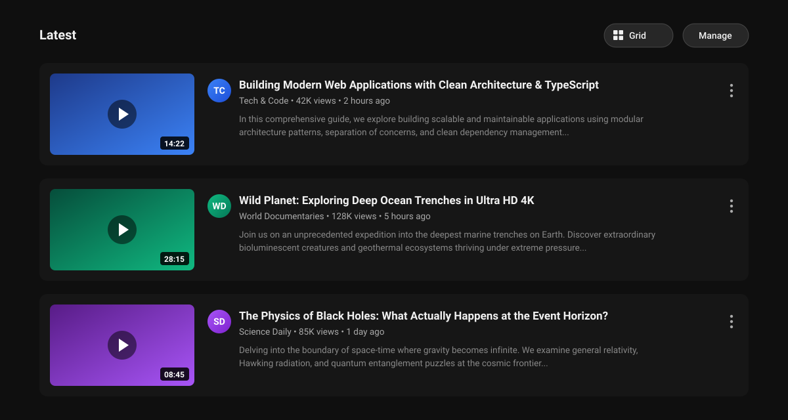

# Subscriptions List View for YouTube™

[](LICENSE)
[](manifest.json)
[](#-installation)
[](https://github.com/timo-rst/yt-list-plugin/releases)

A lightweight and responsive Chromium browser extension (Manifest V3) for **Brave**, **Google Chrome**, **Microsoft Edge**, and other Chromium-based browsers that brings back the clean, classic **horizontal list view for your YouTube™ subscription feed**.

---

## 📸 Preview



---

## 📊 Comparison: Grid vs. Classic List

| Standard YouTube (4-Column Grid) | With this Extension (Classic List View) |
| :--- | :--- |
| ❌ Cluttered 4-tile grid layout | ✅ Clean horizontal rows from top to bottom |
| ❌ Long titles are frequently truncated | ✅ Full video titles are always clearly visible |
| ❌ No video descriptions in subscription feed | ✅ First lines of video description (infobox) shown under views |
| ❌ Easy to miss videos while scanning down | ✅ Structured, linear view — impossible to overlook new uploads |
| ℹ️ Shorts shelves shown as horizontal rows | ✅ Shorts work normally, with an added option to hide them completely |

---

## ✨ Features

- 📜 **Classic Horizontal List View:** Videos are presented in clean, linear rows: thumbnail on the left, channel avatar, title, channel name, views, date, and description snippet on the right.
- 📝 **Live Description Preview:** Automatically fetches and displays the first lines of the video description directly under the metadata.
- 🎛️ **Seamless On-Page Toggle Button:** Placed right next to YouTube's **"Manage"** button in the subscription header (`[ ☷ Grid ]` when list view is active, or `[ ☰ List ]` when grid view is active) to switch views with a single click.
- ⚡ **Automatic Description Toggling:** Switching to grid view automatically hides descriptions and cleanly restores YouTube's default 4-column layout without page reloads.
- 📱 **Flexible Shorts Control:**
  - YouTube Shorts shelves work normally as horizontal scrollable rows (`S S S S S`).
  - You can optionally toggle **Hide Shorts** in settings to completely remove Shorts shelves from your subscription feed.
- 🎚️ **Live Thumbnail Sizing:** Adjust thumbnail width smoothly from **160px to 420px** with instant live preview in your active tab.
- 🌓 **Native YouTube Theme Integration:** Seamlessly adapts to YouTube's dark and light mode color tokens.
- 🛡️ **Lightweight & Privacy-First:**
  - Zero analytics, zero tracking, zero third-party network requests.
  - No aggressive DOM mutation loops.
  - Safe rendering via `textContent` (fully XSS protected).
  - Built-in rate-limit backoff and network timeouts.

---

## 🚀 Installation

### Option A: Install from Release ZIP (Recommended for Users)

1. Download the latest `yt-list-plugin.zip` from [Releases](https://github.com/timo-rst/yt-list-plugin/releases).
2. Unpack the ZIP file to a folder on your computer.
3. Open your browser's extension management page:
   - **Brave:** `brave://extensions`
   - **Chrome:** `chrome://extensions`
   - **Edge:** `edge://extensions`
4. Enable **Developer mode** in the top right corner.
5. Click **Load unpacked** in the top left corner and select the unpacked folder.
6. Open [https://www.youtube.com/feed/subscriptions](https://www.youtube.com/feed/subscriptions) — your subscription feed is now organized as a list!

---

### Option B: Clone via Git (For Developers)

```bash
# Clone the repository
git clone https://github.com/timo-rst/yt-list-plugin.git
cd yt-list-plugin

# Load unpacked in brave://extensions or chrome://extensions
```

---

## ⚙️ Configuration (Popup)

Click the extension icon in your browser toolbar to access options:

- **Main Toggle:** Enable or disable list view globally.
- **Thumbnail Width (160px – 420px):** Live slider to customize the thumbnail size.
- **Description Preview:** Toggle infobox snippets on or off.
- **Hide Shorts:** Option to completely hide Shorts shelves from the subscription feed.
- **On-Page Toggle Button:** Enable or disable the view switcher button next to "Manage".

---

## 📁 Project Structure

```text
yt-list-plugin/
├── manifest.json              # Manifest V3 configuration & permissions
├── content/
│   ├── content.js             # SPA routing, description loader & toggle logic
│   └── styles.css             # Grid & flexbox layouts, theme styling & button styles
├── popup/
│   ├── popup.html             # Settings popup UI
│   ├── popup.css              # Dark theme styling for settings
│   └── popup.js               # Live settings sync via chrome.storage.sync
├── icons/                     # Extension icons (16px, 48px, 128px)
├── docs/
│   └── preview.svg            # Vector UI preview mockup with dummy data
├── scripts/
│   └── package.sh             # Release packaging script
├── .github/                   # Issue templates
├── LICENSE                    # MIT License
└── README.md                  # Documentation
```

---

## 🔒 Privacy Policy

- **No Personal Data Collected:** This extension does not collect, track, or transmit any user data, browsing history, or account credentials.
- **No Third-Party Requests:** All network requests stay strictly within your active YouTube session to fetch public video metadata. No data is sent to external servers.
- **Minimal Permissions:** Uses only `storage` (to save your slider and toggle preferences locally) and host permissions for `youtube.com`.

---

## 🤝 Contributing

Contributions, feedback, and feature suggestions are welcome!
Please check out [CONTRIBUTING.md](CONTRIBUTING.md) and open an [issue](https://github.com/timo-rst/yt-list-plugin/issues) if you encounter any bugs or have ideas for improvement.

---

## 📄 License & Disclaimer

Released under the [MIT License](LICENSE).

> **Disclaimer:** YouTube™ is a trademark of Google LLC. This extension is an independent open-source project and is not affiliated with, endorsed by, or associated with Google LLC or YouTube.
