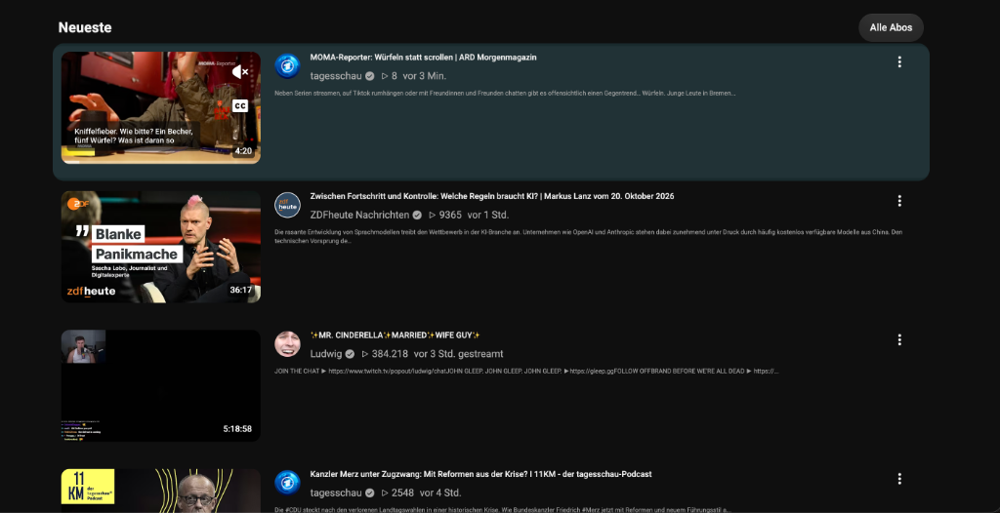

# Abo-Box Listenansicht für YouTube™
### Subscriptions List View for YouTube™

[](LICENSE)
[](manifest.json)
[](#-installation)
[](https://github.com/timo-rst/yt-list-plugin/releases)

Eine schlanke, performante Browser-Erweiterung (Manifest V3) für **Brave**, **Google Chrome**, **Microsoft Edge** und andere Chromium-basierte Browser, welche die klassische, übersichtliche **Listenansicht der YouTube Abo-Box** zurückbringt.

*A lightweight and responsive Chromium extension restoring the classic horizontal subscription feed list view on YouTube™ with live description snippets and customizable thumbnail sizes.*

---

## 📸 Vorschau / Preview



---

## 📊 Vergleich: Kacheln vs. Liste

| Standard YouTube (4-Kachel Grid) | Mit dieser Erweiterung (Klassische Liste) |
| :--- | :--- |
| ❌ Unübersichtliches 4-Spalten-Raster | ✅ Strukturierte horizontale Zeilen untereinander |
| ❌ Titel werden oft abgeschnitten | ✅ Vollständiger Titel immer lesbar |
| ❌ Keine Videobeschreibung auf der Übersichtsseite | ✅ Erste Zeilen der Infobox/Beschreibung direkt sichtbar |
| ❌ Videos gehen beim schnellen Scrollen unter | ✅ Klare visuelle Trennung & maximale Übersicht |
| ❌ Shorts-Blöcke verbrauchen enormen Platz | ✅ Shorts bleiben kompakte horizontale Reihen (`S S S S S`) oder sind ausblendbar |

---

## ✨ Features

- 📜 **Klassische Listenansicht:** Jedes Video erhält einen vollständigen Zeilenstreifen: Thumbnail links, Titel, Kanal-Avatar, Views, Datum und Beschreibungs-Snippet rechts.
- 📝 **Videobeschreibungs-Vorschau (Infobox):** Lädt automatisch die ersten Zeilen der Videobeschreibung nach und zeigt sie dezent unter den Metadaten an.
- 🎛️ **Nahtloser On-Page Umschalter:** Direkt neben dem YouTube-Button **„Alle Abos“** sitzt ein dezenter Umschalt-Button (`[ ☷ Kacheln ]` bzw. `[ ☰ Liste ]`), mit dem jederzeit mit einem Klick zwischen Kachel- und Listenansicht gewechselt werden kann.
- ⚡ **Automatische Beschreibungsabschaltung:** Sobald auf Kacheln umgeschaltet wird, werden alle Beschreibungs-Container automatisch ausgeblendet und das native YouTube-Grid 1:1 wiederhergestellt.
- 📱 **Intelligentes Shorts-Handling:**
  - YouTube Shorts-Regale bleiben als horizontale Leiste (`S S S S S`) mit seitlichem Scrollen formatiert.
  - Optional können Shorts-Sektionen über das Einstellungs-Menü komplett ausgeblendet werden.
- 🎚️ **Live Thumbnail-Slider:** Im Popup lässt sich die Thumbnail-Breite stufenlos von **160px bis 420px** mit sofortiger Echtzeit-Vorschau einstellen.
- 🌓 **Natives Dark- & Light-Design:** Verwendet YouTubes native CSS-Variablen und passt sich nahtlos an Dark- und Light-Theme an.
- 🛡️ **Sicher & Performant:**
  - Keine aggressiven DOM-MutationObserver (keine Endlosschleifen / Memory Leaks).
  - Sicheres Rendering via `textContent` (100% XSS-geschützt).
  - Rate-Limit-Schutz (HTTP 429 Backoff) und 5s-Netzwerk-Timeouts.

---

## 🚀 Installation

### Option A: Als fertige Release-ZIP (Empfohlen für Nutzer)

1. Lade die neueste `yt-list-plugin.zip` unter [Releases](https://github.com/timo-rst/yt-list-plugin/releases) herunter.
2. Entpacke die ZIP-Datei in einen Ordner deiner Wahl.
3. Öffne die Erweiterungsverwaltung deines Browsers:
   - **Brave:** `brave://extensions`
   - **Google Chrome:** `chrome://extensions`
   - **Microsoft Edge:** `edge://extensions`
4. Aktiviere oben rechts den Schalter **Entwicklermodus** (*Developer mode*).
5. Klicke oben links auf **Entpackte Erweiterung laden** (*Load unpacked*) und wähle den entpackten Ordner aus.
6. Öffne [https://www.youtube.com/feed/subscriptions](https://www.youtube.com/feed/subscriptions) – fertig!

---

### Option B: Via Git klonen (Für Entwickler)

```bash
# Repository klonen
git clone https://github.com/timo-rst/yt-list-plugin.git
cd yt-list-plugin

# In brave://extensions oder chrome://extensions als entpackte Erweiterung laden
```

---

## ⚙️ Einstellungen (Popup)

Klicke auf das Erweiterungs-Icon in deiner Browser-Leiste:

- **Hauptschalter:** Listenansicht global an- oder ausschalten.
- **Thumbnail-Breite (160px – 420px):** Ändert die Größe der Vorschaubilder live im Tab.
- **Infobox-Vorschau:** Videobeschreibungs-Snippets ein- oder ausblenden.
- **Shorts ausblenden:** Versteckt YouTube Shorts-Regale komplett aus der Abo-Box.
- **Button auf YouTube:** Steuert, ob der Umschalt-Button neben „Alle Abos“ angezeigt wird.

---

## 📁 Projektstruktur

```text
yt-list-plugin/
├── manifest.json              # Manifest V3 Konfiguration & Berechtigungen
├── content/
│   ├── content.js             # SPA-Routing, Beschreibungs-Lader & Umschalt-Logik
│   └── styles.css             # Grid- & Flexbox-Layouts, Dark-Mode-Styles & Button-Design
├── popup/
│   ├── popup.html             # Einstellungs-Interface
│   ├── popup.css              # Dark-Mode Styling für Einstellungen
│   └── popup.js               # Synchronisation via chrome.storage.sync
├── icons/                     # Erweiterungs-Icons (16px, 48px, 128px)
├── docs/                      # Vorschaubilder & Dokumentations-Assets
├── scripts/
│   └── package.sh             # Build-Skript zur Erstellung der Release-ZIP
├── .github/                   # CI Workflows & Issue Templates
├── LICENSE                    # MIT Lizenz
└── README.md                  # Dokumentation
```

---

## 🔒 Datenschutz (Privacy Policy)

- **Keine Datenerfassung:** Diese Erweiterung sammelt, speichert oder überträgt zu keinem Zeitpunkt persönliche Daten, Account-Informationen oder Browser-Verläufe.
- **Keine externen Server:** Alle Anfragen laufen ausschließlich lokal im Browser direkt gegen YouTube, um öffentliche Videobeschreibungen nachzuladen.
- **Minimale Berechtigungen:** Es werden ausschließlich `storage` (zum Speichern deiner Slider- und Schalter-Einstellungen) und Host-Berechtigungen für `youtube.com` angefordert.

---

## 🤝 Mitwirken / Contributing

Beiträge, Feedback und Feature-Wünsche sind herzlich willkommen!
Lies gerne die [CONTRIBUTING.md](CONTRIBUTING.md) und öffne bei Fehlern oder Ideen einen [Issue](https://github.com/timo-rst/yt-list-plugin/issues).

---

## 📄 Lizenz & Disclaimer

Veröffentlicht unter der [MIT License](LICENSE).

> **Disclaimer:** YouTube™ ist eine eingetragene Marke von Google LLC. Diese Erweiterung ist ein unabhängiges Open-Source-Projekt und steht in keiner geschäftlichen oder offiziellen Verbindung zu Google LLC oder YouTube.
